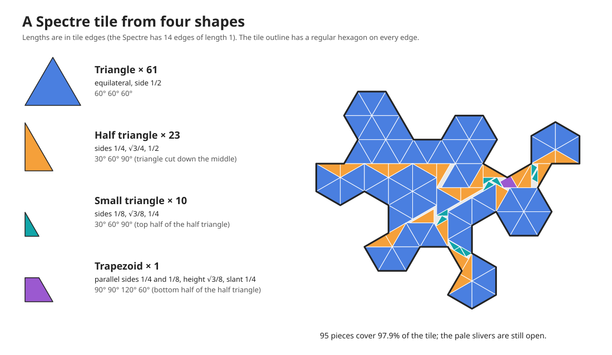
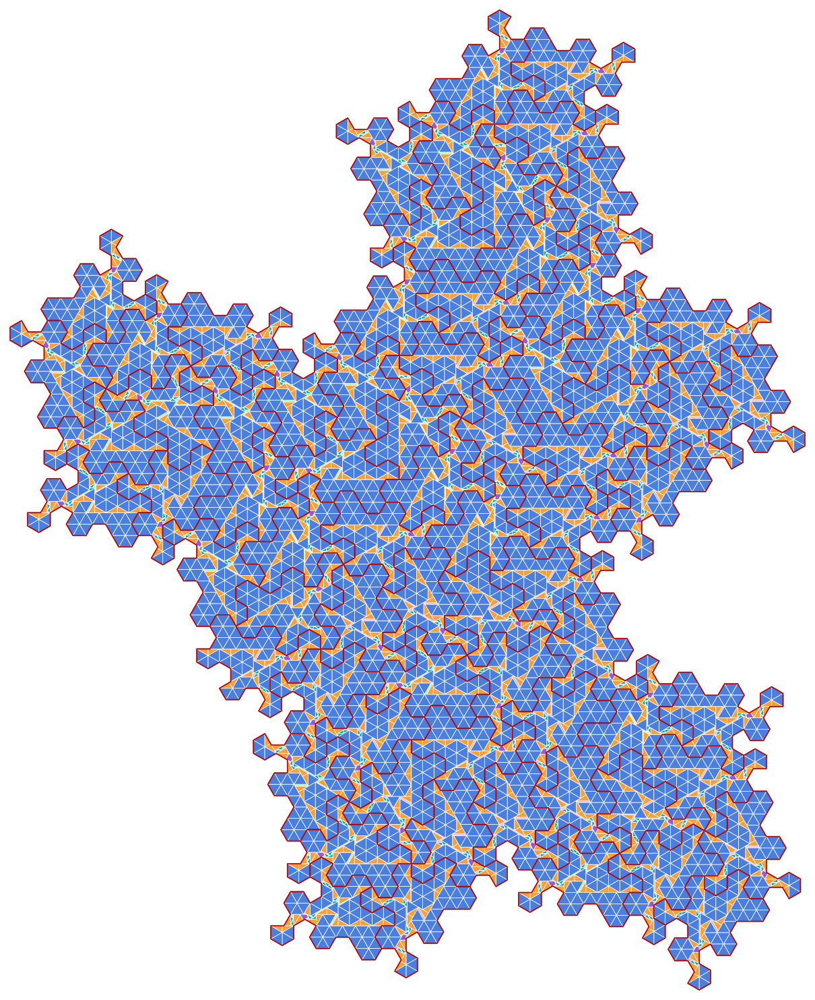

# Spectre mosaic

A [Spectre](https://en.wikipedia.org/wiki/Einstein_problem) tile drawn as a mosaic: the
14-sided tile is filled with a handful of simple shapes instead of being one solid piece.



## The idea

- Start from the straight-sided Spectre (14 edges of equal length).
- Put a regular hexagon on every edge, with the edge as its long diagonal. Going round the
  tile, take the outer half of the first hexagon, the inner half of the next, and so on.
  Those alternating halves become the tile's outline, so every edge is either a bump or a
  matching notch.
- Fill the inside with as few different shapes as possible, with no overlaps.

The tile above uses four shapes, all cut from the same triangle:

| Shape | Size (tile edge = 1) | Per tile |
|---|---|---|
| Triangle | equilateral, side 1/2 | 61 |
| Half triangle | 30-60-90, sides 1/4, √3/4, 1/2 | 23 |
| Small triangle | 30-60-90, sides 1/8, √3/8, 1/4 | 10 |
| Trapezoid | parallel sides 1/4 and 1/8, height √3/8 | 1 |

These 95 pieces cover 97.9% of the tile. The rest is thin slivers where the two triangle
grids, turned 30° from each other, meet.

The hexagon-edged tile was checked to fit together with copies of itself: `spectre.svg`
includes a 71-tile patch built by the Spectre substitution rules, with no overlaps and no
holes. The edge shape is not claimed to force aperiodicity.

## The tiling patch

The same 71 tiles, each drawn with its 95 pieces. Dark red lines are the tile outlines.



## Build it yourself

```
python3 make_spectre.py
```

writes `spectre-shapes.svg` and `spectre-patch.svg` from scratch. The script needs only
Python 3: it holds the tile's 14 corners and the 95 pieces as data, derives the
hexagon-edged outline, builds the 71-tile patch with the Spectre substitution rules, and
refuses to write anything if two pieces overlap. Both pictures on this page are its output.

## Files

- `spectre.svg` is the working drawing: a locked reference tile, an editable working tile
  with numbered hexagons and corner labels, loose pieces to drag around, and the 71-tile
  patch showing the pieces inside every tile.
- `make_spectre.py` generates the two pictures on this page.
- `spectre-shapes.svg` and `spectre-patch.svg` are those pictures.
- `scratch/` holds the throwaway scripts from the drawing session, kept for the record; see
  its README.

## Earlier versions

The drawing went through several piece sets on the way here. Git tags mark the milestones:

- `full-fill-17-pieces`: 17 larger pieces per tile, including custom shapes (99.9%).
- `two-shape-victory`: only triangles and half triangles (95.8%).
- `four-shape-97`: the four shapes above (97.9%).

## How it was made

Drawn in Inkscape, with [Claude Code](https://claude.com/claude-code) driving the running
Inkscape window step by step and checking each piece for overlaps before placing it.

The Claude Code skill used for that is included in `.claude/skills/inkscape-live/`, so it is
available automatically when Claude Code is started in a clone of this repo:

- `SKILL.md` describes how to control a running Inkscape over D-Bus, how to read back edits
  made by hand, and how to test whether shapes fit.
- `ink.py` is the helper it uses. It also works on its own, for example
  `python3 .claude/skills/inkscape-live/ink.py overlaps spectre.svg --under tileR --match '^(ctri|chalf|rsplit|rcut|cq)'`
  reports any overlapping pieces on the working tile.

It was written for Inkscape 1.4 on Linux and needs `gdbus` for the live commands.
